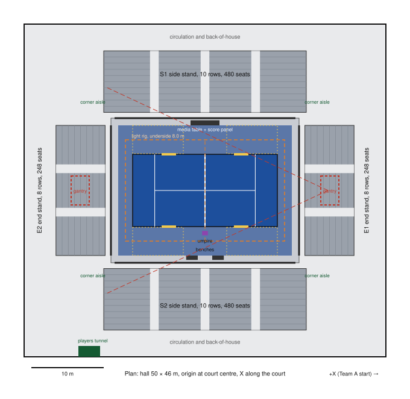
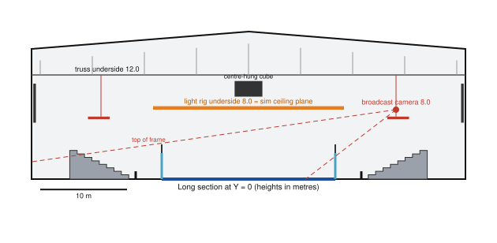

# Arena spec: the indoor show court venue

Status: **v0.1, proposal for Caio's review.** Owner: venue art. Implements GDD section 10 ("one indoor club court ... arena lighting ... a small indoor crowd") and supports sections 2 (court, 8.0 m ceiling), 9 (broadcast camera) and 12 (slice: 60 fps on the target PC and an M2 Pro Mac).

This is the brief for the venue that surrounds the court: the building, the floor around the court, stands and crowd, lighting, screens, signage, props, sound and the performance budget. It does not change the court itself (GDD 2 and `Source/PadelCore/Public/CourtSpec.h` own that) or the camera rules (GDD 9, `Data/Camera.json`). Where this spec and the GDD disagree, the GDD wins.

**What it is:** a mid-size indoor sports hall set up for a club championship, with one show court in the middle, temporary grandstands on all four sides, a lighting rig hung over the court and two broadcast camera gantries. It should read as a televised indoor padel match: a bright, even court in a darker room, a crowd you can feel but that never competes with the ball.

All positions are in **metres, simulation space** (GDD 2): origin at the court centre, X along the court (−10 to +10), Y across (−5 to +5), Z up, Team A starts on +X. The Unreal world is ×100. Every number here is a starting value; once built, layout numbers live in the asset pipeline config and tuning numbers in `Data/` (section 15), not in code.

---

## 1. Design rules (in priority order)

1. **The ball is the brightest, clearest thing on screen** (GDD 10). Nothing in the venue may be brighter than the lit ball, share its yellow-green hue, or move behind the back glass while the ball is live.
2. **What the player sees matches the rules.** The only thing over the court is the light rig, and its underside sits exactly at the 8.0 m ceiling plane (`Padel::Court::CeilingHeight`), so a lob that hits "the ceiling" visibly hits the rig.
3. **Spend detail where the camera looks.** The broadcast camera sees the far end of the hall and almost nothing else during play (section 3). That zone gets the hero budget; the roof and the end behind the camera get the least.
4. **Original and sponsor-free.** No real brands, venues, tours, events, players or likenesses, anywhere (CLAUDE.md, GDD 1).
5. **Mac first-class.** Everything works on Metal and holds 60 fps at 1080p on an M2 Pro (section 14).

---

## 2. Building

A steel portal-frame sports hall, clear span, rectangular.

| Element | Value | Notes |
|---|---|---|
| Interior footprint | 50.0 (X) × 46.0 (Y) | X −25 to +25, Y −23 to +23 |
| Eaves height (side walls) | 15.0 | |
| Ridge height | 17.0 | Shallow gable (about 5°), ridge along X |
| Roof trusses | Flat-bottom steel trusses spanning Y, 6.0 m centres along X (X = −24, −18 ... +24), bottom chord at 12.0, depth 2.8 | Galvanised grey, painted dark above 12 m so the roof recedes |
| Roof deck | Dark acoustic deck with a perforated liner | Read as a dark ceiling with a regular truss rhythm |
| Clerestory | Translucent polycarbonate band on both long walls (Y = ±23), Z 12.5 to 14.5, full length | Motorised blackout blinds (section 6.4) |
| Side walls (Y = ±23) | 0 to 2.6: painted concrete block, dark grey; 2.6 to 12.5: vertical acoustic panels, dark slate blue | Panels 1.2 m wide, vertical seams |
| End walls (X = ±25) | Same materials; video wall at 6.5 to 11.0 (section 8) | |
| Floor slab | Dark polished concrete, Z = 0 | Visible only in circulation |
| Services | Ducts, cable trays and sprinkler mains run between the trusses above 12 m | Low detail, but they make the roof read as real |

Why this size: the court plus its surround needs about 26 × 20 m, the stands add about 7 to 9 m on each side, and the camera gantries need to sit 6 to 8 m behind each back glass (GDD 9). 50 × 46 m is a believable municipal or club hall, not a stadium, which fits "a small indoor crowd".

Roof heights above 12 m are cosmetic. The **simulation ceiling stays at 8.0 m** (GDD 2); the light rig makes that limit visible (section 6.1).

---

## 3. What the broadcast camera sees

The default camera (`Data/Camera.json`: 8.0 m high, 7.0 m behind the human team's back glass, looking at a point 2.0 m past the net, 50° horizontal field of view) sits at about (+17, 0, 8) when the human team is on +X, and at (−17, 0, 8) after a change of ends. At 16:9 that frame covers:

| Where | What is in frame |
|---|---|
| Bottom edge | Hits the floor at about X = +6.6: the near back glass, the near apron and everything behind the camera are **out of frame** |
| Top edge | About 7.0 m high at the near back wall, 4.1 m at the far back glass (X = −10), 3.6 m at the far boards (X = −13.5), 2.7 m at X = −20 |
| Width | About ±12.6 m at the far back glass, ±14 m at the far boards |

So during play the camera shows: the court, the far apron and boards, the **lower 5 to 6 rows of the far end stand**, the far corners and the far third of both side stands. It never shows the roof, the rig (top edge passes 0.85 m under the near end truss), the video walls, or the near end. With ±1.5 m tracking this barely changes.

This sets three detail zones used throughout this spec:

| Zone | Contents | Treatment |
|---|---|---|
| **A, hero** (always in the play frame, at both ends because the camera swaps) | Court surround, end boards, both end stands' lower rows, stand corners, benches and umpire (partly), the backdrop band behind each back glass | Full material detail, near-row crowd LOD0, strict readability rules (section 5.3) |
| **B, cut-aways** | Side stands, benches, umpire chair, media table, players' tunnel, centre-hung cube, gantries, video walls | Good detail; seen in between-point shots and the walk-out |
| **C, never in a gameplay shot** | Roof, upper walls, circulation behind the stands, back-of-house | Simple Nanite meshes, flat materials, low texel density |

Note for the camera owner: high lobs (above about 4.9 m over X = −5) leave the top of this frame. That is a camera question, not a venue one, but if the camera ever tilts up, the far end wall and gantry come into frame and move from zone B to zone A.

---

## 4. Floor around the court

| Area | Extent | Surface |
|---|---|---|
| Court | X ±10, Y ±5 | GDD 2; owned by the court surface work |
| Apron (run-off) | To X ±12.0 and Y ±9.0 (2.0 m behind each back wall, 4.0 m beside each side wall) | Same turf build as the court in a darker blue-grey (proposed `#1f3a66`), no lines. Matches `RunoffBack = 2.0` and `RunoffSide = 4.0` in `CourtSpec.h` |
| Event floor | Apron edge to the boards (X ±13.0, Y ±10.0) | Black rubber event tiles, 1 m grid, roughness 0.85 |
| Exit keep-clear zones | X 3 to 10 and −3 to −10, from the side glass to the side boards, both sides | Nothing placed here: these are the paths out of the four exits (`ExitNearX` 4.0 to `ExitFarX` 6.0) for out-of-court play, a rule that is in the slice even though players don't play it yet (GDD 12) |
| Circulation | Everywhere outside the boards and stands | Polished concrete, cable mats and gaffer-taped cable runs near the gantries |

The apron is part of the play space (`ball_left_court` happens over it), so it must be clean of props, and its edge must be visible against the event floor.

---

## 5. Stands and crowd

### 5.1 Stands

Temporary steel grandstands (scaffold frame underneath, visible at the sides), molded plastic seats on aluminium planks.

| Stand | Front edge | Rows | Length | Seats per row | Seats |
|---|---|---|---|---|---|
| S1 side (+Y) | Y = +10.8 | 10 | X −14 to +14 | 48 (three 1.2 m stair aisles at X = −7, 0, +7) | 480 |
| S2 side (−Y) | Y = −10.8 | 10 | X −14 to +14 | 48 | 480 |
| E1 end (+X) | X = +13.8 | 8 | Y −9 to +9 | 31 (two aisles at Y = ±3) | 248 |
| E2 end (−X) | X = −13.8 | 8 | Y −9 to +9 | 31 | 248 |
| **Total** | | | | | **1,456** |

Rows: tread 0.85 m, rise 0.40 m, first row floor at 0.50 m, seat pitch 0.50 m, glass-free steel front rail 1.0 m high, back rail 1.1 m. Side stand top row floor at 4.1 m, end stand top row at 3.3 m.

- **No glass balustrades** anywhere: every extra translucent surface costs frame time (section 14) and competes with the court glass.
- **Seat colour:** dark slate (`#2b3038`) so empty seats read dark, not as bright gaps.
- **Front rail and stand fascia:** matte charcoal, 0.9 m fascia panel on the front of each stand that can carry house signage (section 9).
- Corners stay open: they are the entrances (section 10).

### 5.2 Crowd placement

- Seats are generated as sockets from the table above (row, seat, stand). The crowd fills them, so changing a stand changes the crowd with no hand placement.
- **Slice default occupancy: 70%** (about 1,020 spectators). Front rows fill first (90% in rows 1 to 3, falling to 50% in the back rows); the end stands fill slightly less than the sides.
- Placement is **seeded and reproducible**: a cosmetic RNG seeded from the match seed picks who sits where, so the same match looks the same in a screenshot or a replay. This RNG is in `Padel` (presentation), never in `PadelCore`, and never touches simulation state.
- Small groups: 70% of spectators sit in clusters of 2 to 4 with shared clothing temperature (a family, a club group), not uniform noise.
- Standing people: 6 to 10 in the corner aisles and behind the end stands (staff, late arrivals). Zone B and C only.

### 5.3 Readability rules for the crowd and everything behind the glass

The band behind each back glass (from the floor to 4 m high, ±13 m wide) is behind the ball for most of every rally. In that band:

- Average luminance at most **25% of the lit ball** (measured on the locked broadcast exposure).
- **No yellow, lime or green-yellow** (hue 50° to 90°) in clothing, seats, signage or screens: that is the ball's colour (`#e8ff1f`).
- No large patches of either team's kit colour (`#c8321e` red, `#6f2fa3` purple) so kits stay readable against the crowd. Spectator clothing is drawn from a muted palette (navy, grey, charcoal, white, denim, muted earth tones) with at most 10% saturated accents, none in the excluded hues.
- No motion larger than seated idle animation while the ball is live (section 5.4), and no screen content changes behind the glass during a point (section 8).

### 5.4 Crowd behaviour

Driven by the existing `UPadelMatchEvents` delegates (GDD 3.4), never by the simulation directly:

| State | Trigger | What the crowd does |
|---|---|---|
| Idle | Between points | Seated idle, small talk, phone, drink. Low amplitude |
| Hush | `OnServeStarted` | Settle and face the court; animation amplitude drops |
| Follow | During the rally | Heads track the ball loosely (per-instance look-at, coarse) |
| React small | `OnPointEnded` | Applause, length scaled by rally length |
| React big | Point that wins a game, `OnGoldenPointStarted`, `OnSetWon`, `OnMatchWon` | Applause, some stand up (front rows first), arms up |
| Gasp | A rally shot after an `OnBallBounced` with surface `glass` that is returned | Brief "ooh" lean (no standing) |
| Change-over | `OnChangeOfEnds` | Stretch, chatter, a few walk the aisles |

---

## 6. Lighting

The lighting thread ("Build realistic court lighting and venue") owns the fixture layout, presets and exposure. This section sets the envelope its next iteration should meet. Its current indoor preset (1,090 lux, 0.76 uniformity, no beam within 15° of the broadcast camera) already meets the court targets below.

### 6.1 The light rig (and the ceiling plane)

- A rectangular box-truss frame (0.40 m square section, black) hung from the roof trusses on chain hoists: perimeter at **X ±11.0, Y ±7.0**, with one cross truss over the net line (X = 0).
- **Rig underside at exactly Z = 8.0**, the simulation ceiling. Nothing hangs below it over the court footprint: fixtures sit inside the truss, lenses flush with or above its underside.
- Court floodlights mount only on the two long trusses (Y = ±7.0) and the four corners. **None on the end trusses** (they face the camera) and **none on the net cross truss** (looking up at a lob would stare into it).
- The top edge of the broadcast frame passes about 0.85 m below the near end truss (section 3). Any camera change that brings the rig into frame needs this spec updated.

### 6.2 Targets

| Area | Target | Colour temperature |
|---|---|---|
| Court, horizontal | ≥ 1,000 lux average, uniformity (min/avg) ≥ 0.7 | 5,600 K |
| Court, vertical toward each broadcast camera at 1.0 m | ≥ 750 lux | 5,600 K |
| Apron | ≥ 700 lux, falling off smoothly to the boards | 5,600 K |
| Stands (house lights) | 150 to 250 lux on the seats, front rows brighter than back | 3,500 K, slightly warm |
| Circulation and back-of-house | 50 to 100 lux | 4,000 K |
| Video walls and LED boards | Emissive only, not light sources (section 8) | |

The ratio between court and stands (about 5:1) is what makes it look like television: a bright court in a darker room.

### 6.3 Glare

- No luminaire visible from either broadcast camera position within 15° of its view axis.
- No luminaire in a player's view when looking up at a lob from anywhere on the court at an angle above 45° (that is why there are none over the court interior).
- Glass reflections of fixtures are allowed (they read as real) but must not land on the ball's usual path at the far back glass in the default frame; check with the look-dev camera bookmark.

### 6.4 Natural light

- **Slice preset "Evening session": blinds closed, no daylight.** No sky light from outside, which also saves Lumen work.
- Post-slice preset "Afternoon session": blinds open, low sun through the clerestory. The sun direction is chosen so the patches of sunlight land on the upper side stands and walls, **never on the court or the apron**, and the court stays lit by the rig at the same exposure.

---

## 7. Broadcast positions

| Position | Where | Use |
|---|---|---|
| Gantry +X and −X | Suspended platforms from the roof trusses, X ±16.0 to ±18.5, Y ±2.0, deck at Z 6.9, camera lens adjustable 7.0 to 9.0 (GDD 9: 7 to 9 m high, 6 to 8 m behind the glass) | The default broadcast camera; one per end for the change of ends |
| Net-side camera | On a 0.6 m riser behind the media table on the S1 side (+Y), X = 0, Y = +9.8, lens 2.2 m | Post-slice replays (GDD 9: side camera along the net); a cut-away until then |
| Corner cameras | On the event floor at the four corners, just outside the boards, lens 1.5 m | Cut-aways of the server, celebrations |
| Players' tunnel camera | At the tunnel mouth | Walk-out (post-slice) |
| Overhead | A small remote camera on the net cross truss, looking down | Post-slice replays only |

Physical camera props (generic shapes, no brand marks) and operators stand at the floor positions, so they appear in each other's shots. The gantries carry a camera, an operator and a commentary desk (empty in the slice).

---

## 8. Scoreboards and screens

All screens get their content from the same `FScoreSnapshot` the HUD uses (`OnScoreChanged`), so the venue can never disagree with the score bug. They are drawn from render targets that update only on events, not every frame.

| Screen | Size and place | Content | Rules |
|---|---|---|---|
| Centre-hung cube | 4 faces of 3.2 × 1.8 m, hung above the net, bottom at Z 9.5 | Score, server, team colours | Above the ceiling plane, out of the play frame |
| End video walls | 8.0 × 4.5 m on each end wall, X ±24.8, Z 6.5 to 11.0 | Score, between-point graphics, the venue identity | Out of the play frame; free to animate |
| Courtside score panel | 1.2 × 0.8 m at the media table, X = 0, Y = +9.3, Z 0.8 to 1.6 | Score in large type for the players | Static during a point |
| LED boards | 0.9 m high ribbon on the boards line: X = ±13.0 (Y ±9) and Y = ±10.0 (X ±12.5) | House graphics, score at change-overs | **Behind the back glass (the end boards): dark static content while the ball is live, max 25% of ball luminance**; animate only between points |

Screens are emissive materials, not lights. Keep emissive intensity low enough that Lumen does not throw coloured light onto the court (the lighting thread sets the cap).

---

## 9. Signage (original, sponsor-free)

- **No real brands, sponsors, tours, events, clubs or venues.** No invented sponsors in the slice either: the boards and fascias carry **house content** only.
- House content: the venue's own identity, an event title in plain words ("Club Championship"), the game's working title wordmark only once Caio settles the name (GDD 13.2), abstract geometric patterns in the venue palette, and court information (court number, "please remain seated during play").
- The venue gets an invented name before any text goes on a board. Run it through `Tools/AssetPipeline/config/blocklist.txt` and a web search for real venues, clubs and brands (CLAUDE.md); record the check in `SourceArt/manifest.csv`.
- Safety signs (exit, first aid, fire extinguisher) use generic standard pictograms, which are not brands.
- **Venue palette:** charcoal `#1e2126`, slate blue `#2b3a55`, off-white `#e9ecef`, one accent in cyan-teal `#2fa4b8`. Teal is far from the ball's yellow-green and from both kit colours.
- Text is in a single typeface family that the UI also uses (licence recorded in the manifest).

---

## 10. Entrances and circulation

| Entrance | Where | Notes |
|---|---|---|
| Players' tunnel | A corridor from a door in the −Y wall (X −14.5 to −17.5) to the −X/−Y corner aisle | 3.0 m wide, 2.8 m high, lit portal with a short black drape. The walk-out and the post-match exit |
| Corner aisles | The four gaps between side and end stands | 3.5 m wide; public access to the floor seats and stands |
| Vomitories | Behind each side stand at X = −7, 0, +7 (stairs down from the top row) | Public access from circulation |
| Fire exits | Two per long wall, one per end wall, double doors with push bars and illuminated exit signs | Mandatory for realism; zone C |
| Loading door | One large roller door on the +X end wall, closed | Zone C, low detail |

---

## 11. Courtside: benches, umpire, media table

| Item | Where | Notes |
|---|---|---|
| Umpire chair | X = 0, Y = −5.9 (just outside the net post on the −Y side), seat at 1.8 m | Umpire character seated; ladder on the outer side |
| Team benches | Two benches on the −Y side at Y −9.0 to −9.6: Team A's at X +1.0 to +2.6, Team B's at X −2.6 to −1.0 | Each with two chairs, towels, water bottles, a racket bag, a small cooler, all unbranded. Benches stay in the X ±2.6 strip to keep the exit zones clear |
| Media and officials table | +Y side, X ±2.0, Y +9.0 to +9.7 | Three chairs, laptops, the courtside score panel |
| Ball supply | A plain ball tube rack at the umpire chair | Unbranded tubes |

Teams change ends but keep their bench (real padel players walk to their bench at the change-over). If this reads wrong in playtests, swapping benches is a data change.

---

## 12. Materials and props

All materials are instances of the masters the import script already builds (`Tools/AssetPipeline/config/palette.json`: Opaque, Masked, Glass, Emissive, Turf), added under a new `venue` group.

| Material | Master | Colour | Roughness | Notes |
|---|---|---|---|---|
| Acoustic wall panel | Opaque | `#2b3a55` | 0.9 | Micro-perforation in the normal map |
| Concrete block (painted) | Opaque | `#3a3d42` | 0.8 | |
| Polished concrete floor | Opaque | `#4a4d52` | 0.35 | Soft reflections of the court in circulation |
| Event floor tiles | Opaque | `#16181b` | 0.85 | 1 m grid |
| Apron turf | Turf | `#1f3a66` | 0.92 | Less sand than the court |
| Truss and rig steel | Opaque, metallic 1 | `#1a1b1e` | 0.5 | Rig black; roof trusses `#6b6f75` grey |
| Seats | Opaque | `#2b3038` | 0.55 | |
| Stand steel and scaffold | Opaque, metallic 1 | `#8b9096` | 0.5 | Galvanised |
| Board and fascia face | Emissive | content | n/a | Behind-glass cap in section 5.3 |
| Drapes (tunnel, gantry skirts) | Opaque | `#0f1012` | 0.95 | |
| Polycarbonate clerestory | Opaque with emissive at night off | `#cfd6dc` | 0.4 | Not translucent, to keep it cheap |

Prop list (all original designs, no marks): umpire chair, 2 benches, 4 chairs, towels, 6 water bottles, 2 coolers, 2 racket bags, media table with 3 chairs and 2 laptops, ball tube rack, 4 floor cameras on tripods, 2 gantry cameras, cable runs and cable mats, 6 fire extinguishers, 1 first-aid cabinet, exit signs, handrails, chain hoists on the rig, ducts and sprinkler mains in the roof, a few bags and jackets on empty seats.

---

## 13. Audio ambience

The GDD's audio list (GDD 10) covers the court sounds; this section covers the room.

- **Room acoustics:** a hall of about 37,000 m³ with acoustic panels and a crowd. Target reverb time about **1.6 s** in the mid frequencies with the crowd in, pre-delay about 25 ms, strong early reflections near the glass. One reverb submix; sends of about 15% for court sounds and 35 to 40% for crowd and PA.
- **Beds (looping, positioned on the four stands):** crowd murmur scaled by occupancy; room tone and ventilation hum, very low; a faint PA hiss between points.
- **Event layers (from `UPadelMatchEvents`):** the crowd hush on `OnServeStarted` (the murmur ducks about 12 dB within 0.5 s), applause on `OnPointEnded` (length and level from rally length and point importance), the "ooh" on returned glass shots, a bigger reaction on game, set and match wins, chatter and original PA music only at change-overs.
- **Readability:** the crowd bed must never mask the ball on the racket, the glass ring or the mesh rattle (GDD 10). During a rally the crowd sits at least 12 dB below the ball sounds.
- `EPadelMatchSound` already has `CrowdPoint` and `CrowdBigPoint`. The rest (murmur loop, hush, ooh, change-over chatter, room tone) are new entries; adding them is a shared-contract change and goes in its own PR. Mix levels go in a new `Data/Audio.json` (section 15).
- All crowd and PA audio is original or properly licensed, recorded in the manifest. No recognisable chants, songs or announcer catchphrases.

---

## 14. Performance budget and LODs

Target: **60 fps at 1080p on an M2 Pro** (Metal, the Mac Lumen profile the lighting thread is setting up) and on an RTX 3060 class PC. That is 16.6 ms per frame. Starting GPU budget, to be measured with `stat gpu` and Unreal Insights on the Mac and adjusted:

| Item | GPU ms (M2 Pro, 1080p) |
|---|---|
| Court, glass and net | 3.0 |
| Players, rackets and ball | 3.0 |
| **Venue static geometry (Nanite)** | **1.5** |
| **Crowd** | **1.5** |
| Direct lighting and shadows | 2.5 |
| Lumen GI and reflections | 3.0 |
| Post-process, TSR and UI | 1.5 |
| Headroom | 0.6 |

Venue rules:

- **Static venue geometry is Nanite** (shell, stands, trusses, rig, props), opaque materials only. No translucent venue surfaces except where this spec names them (none in the slice).
- **Non-Nanite venue draw calls ≤ 150** in the play frame (crowd, any masked or animated parts).
- **Venue materials ≤ 20 unique** (instances of the shared masters), venue texture memory ≤ 300 MB at 1080p.
- **Texel density:** zone A 512 px/m, zone B 256 px/m, zone C 64 px/m.
- **Shadow-casting lights:** court floodlights cast shadows; house, circulation and roof lights do not. Emissive screens and boards are never lights.
- **Lumen:** the venue is mostly dark and matte, which keeps Lumen cheap. Exclude zone C meshes from Lumen reflections where possible (far from the camera, never reflected in the glass).
- **Crowd:**
  - Instanced static meshes with vertex animation textures (baked idle, hush, clap, cheer, stand loops), per-instance time offset and tint. Not skeletal, not Nanite (it animates).
  - 8 body variants × 6 clothing palettes from the muted palette in section 5.3.
  - LOD0 ≤ 4,000 triangles (front 3 rows of the far end stand and the corners), LOD1 ≤ 1,000, LOD2 an impostor card. Screen sizes start at 0.15 and 0.05.
  - At most 1,456 instances, in one instanced component per variant per LOD.
  - Zone C crowd (behind the camera) is culled during play.
- **Levels:** one persistent arena level with sublevels for shell, stands, crowd, lighting and dressing, so each area can be loaded and profiled alone.
- **The Mac check before merge:** play a full game in the venue on the M2 Pro and record frame time; the venue PR fails review if it pushes the frame above 16.6 ms.

---

## 15. Where the numbers live

Following CLAUDE.md (tuning data is text):

| File | Contents |
|---|---|
| `Tools/AssetPipeline/config/arena.json` (new) | Every layout number in sections 2, 4, 5.1, 7, 8, 10 and 11, read by a parametric venue builder, so a stand or the hall size changes by editing text and re-running the pipeline |
| `Tools/AssetPipeline/config/palette.json` | A new `venue` group with the section 12 materials |
| `Data/Crowd.json` (new) | Occupancy by stand and row, cluster sizes, palette weights, reaction timings |
| `Data/Audio.json` (new) | Bed and event levels, ducking, reverb send amounts |
| The lighting thread's preset data | Section 6 targets |

The venue is cosmetic: none of it goes into `PadelCore` except the existing ceiling plane, which already lives in `CourtSpec.h`.

---

## 16. Build order (the next iterations)

1. **Shell and floor:** hall, roof trusses, apron and event floor, from `arena.json`. Check the camera frame against section 3.
2. **Light rig at 8.0 m** with the lighting thread's fixtures on it; confirm the targets in section 6.2.
3. **Stands and seat sockets**, then the crowd at LOD2 only, then LOD0 and LOD1.
4. **Boards and screens** with house content, wired to `OnScoreChanged`.
5. **Courtside props**, benches and umpire.
6. **Crowd reactions** and **room audio** (needs the `EPadelMatchSound` contract PR).
7. **Profile on the M2 Pro** and trim to the section 14 budget.

## 17. Done when

1. The default broadcast frame from both ends matches section 3 and shows no rig, roof or screen.
2. Court lux and uniformity meet section 6.2 in the lighting thread's measurement.
3. The behind-the-glass band passes section 5.3 in a screenshot check (luminance and hue).
4. No real brand, venue or likeness anywhere; every new name was searched and recorded.
5. A full match in the venue holds 60 fps at 1080p on the M2 Pro and the target PC.
6. Caio, in a playtest, can always see the ball against the far end, and says it looks like a televised indoor match.

## 18. Open decisions for Caio

Defaults are picked so work isn't blocked.

1. **Size of the crowd.** 1,456 seats at 70% (default) or a smaller club feel (side stands only, about 600 seats)? The GDD says "a small indoor crowd"; this default is a small arena rather than a club with bleachers.
2. **End stands or dark backdrops.** Spectators behind each back glass (default, more alive) or a dark drape behind each back glass with stands only on the sides (cleaner ball read, cheaper)?
3. **Centre-hung cube.** Keep it (default) or drop it for a cleaner roof?
4. **Venue name.** Needs an invented name before any signage text goes in.
5. **Benches.** Keep each team's bench for the whole match (default) or swap at change of ends?
